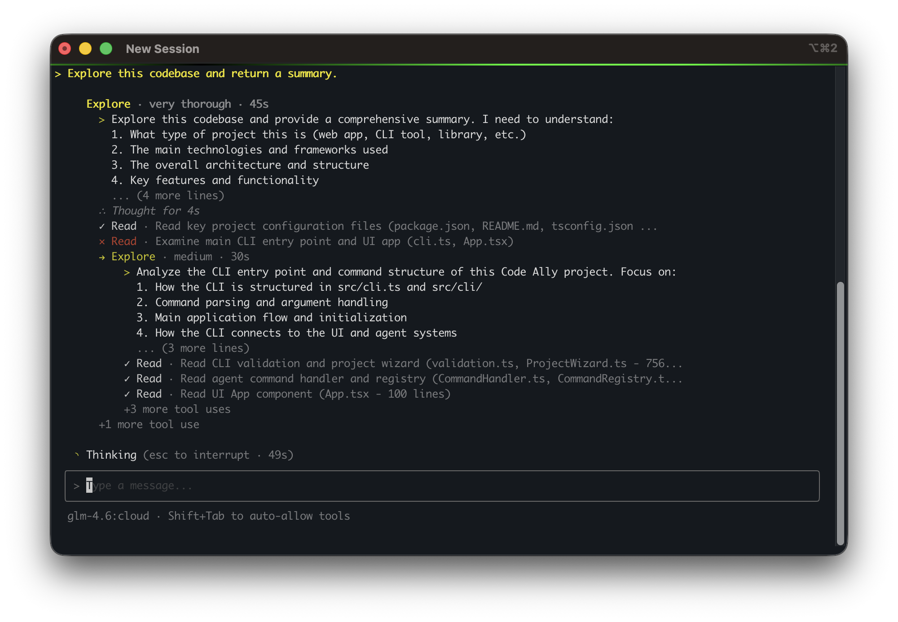

# Code Ally <sup style="color: #ffc800;">( ^)></sup>

<p align="center">
  
</p>

Terminal-based AI coding assistant that runs in your CLI. Built with TypeScript, React, and Ink. Heavily inspired by [Claude Code](https://github.com/anthropics/claude-code).

Code Ally gives you an AI that lives where you work—your terminal. It reads your code, runs your commands, and remembers your conversation across sessions. When the built-in tools aren't enough, write your own in Python or Node.js. When one agent isn't enough, create specialists that delegate to each other.

## Feature Spotlight

- **Expert delegation** — Delegate to specialized agents created by you or Ally
- **Agent skills** — Reusable workflows that load on-demand (open standard)
- **Todo list** — Ally can keep a todo list as it works to stay on track
- **Plugins** — Extend with custom tools and agents in Python or Node.js
- **Change tracking** — Full undo support for file modifications
- **Session persistence** — Resume conversations across restarts
- **Hooks** — Run your own commands at session and tool boundaries to enforce policy
- **Headless mode** — Drive Ally over a JSON protocol and read typed results back

## Recommended Models

Tested to work best with these models:

- `gpt-oss:20b` — Balanced performance and speed
- `gpt-oss:120b` — Best quality for complex tasks
- `glm-4.6:cloud` — Cloud-hosted option via Ollama

## Installation

```bash
npm install
npm run build
npm link  # Makes 'ally' command available globally
```

Requires Node.js 22 or newer.

## Usage

```bash
ally                        # Start interactive session
ally --model llama3.2       # Use specific model
ally --once "explain this"  # Single message mode
ally --resume               # Resume previous session
ally --init                 # Initial setup
ally --profile work         # Use profile
```

Mouse reporting is off by default so new approvals do not interrupt native terminal scrollback. `/config set mouse_support=dialogs` enables clicks in dialogs and focused fleet lists; `mouse_support=always` enables clicks throughout the UI. These opt-in modes may capture the scroll wheel; `mouse_support=off` restores native scrolling.

## Commands

### Core

| Command | Description |
|---------|-------------|
| `/help [topic]` | Show help, optionally filtered by topic |
| `/config` | View configuration; `/config set key=value` to modify |
| `/model <name>` | Switch LLM model |
| `/compact [instructions]` | Create a durable semantic checkpoint and free model context |
| `/undo` | Revert file changes (interactive selector) |
| `/rewind` | Go back to earlier message |
| `/resume [session]` | Resume previous session |
| `/clear` | Clear conversation history |
| `/init` | Run setup wizard |
| `/exit` | Exit the application |

### Agents

| Command | Description |
|---------|-------------|
| `/agent list` | List available agents |
| `/agent create` | Create new agent (wizard) |
| `/agent use <name> <task>` | Run task with specific agent |
| `/agent show <name>` | View agent details |
| `/agent delete <name>` | Delete an agent |
| `/agent active` | Show pooled agents |
| `/agent stats` | Pool statistics |
| `/agent clear [id]` | Clear agent(s) from pool |
| `/switch <agent>` | Switch to different agent |
| `/switch ally` | Return to main agent |

### Skills

| Command | Description |
|---------|-------------|
| `/skill list` | List available skills |
| `/skill show <name>` | View skill details |
| `/skill reload` | Reload skills from disk |

### Project

| Command | Description |
|---------|-------------|
| `/project init` | Initialize ALLY.md |
| `/project view` | View project context |
| `/project edit` | Edit ALLY.md |
| `/focus <path>` | Restrict operations to directory |
| `/defocus` | Clear focus restriction |
| `/add-dir <path>` | Add working directory |
| `/remove-dir <path>` | Remove working directory |
| `/list-dirs` | List working directories |

### Other

| Command | Description |
|---------|-------------|
| `/todo` | View todo list |
| `/todo add <task>` | Add task |
| `/prompt` | Browse saved prompts |
| `/prompt add` | Save new prompt |
| `/task list` | List background tasks |
| `/task kill <id>` | Kill background task |
| `/plugin list` | List plugins |
| `/plugin info <name>` | Plugin details |
| `/debug` | Debug tools (`enable`, `disable`, `calls`, `errors`, `dump`) |

## Input Modes

Special characters at the start of input:

| Prefix | Action |
|--------|--------|
| `!command` | Run bash command directly |
| `#note` | Save note to ALLY.md |
| `@path` | Mention file or directory |
| `+plugin` | Enable plugin for session |
| `-plugin` | Disable plugin for session |

## Tools

The agent has access to these built-in tools:

**File Operations**
- `read` — Read file contents (supports offset/limit for large files)
- `write` — Create new files
- `edit` — Find-and-replace text editing
- `line-edit` — Edit by line number (insert, delete, replace)

**Search & Discovery**
- `glob` — Find files by pattern (`*.ts`, `**/*.test.js`)
- `grep` — Search file contents with regex
- `ls` — List directory contents
- `tree` — Display directory structure

**Execution**
- `bash` — Run shell commands (with timeout, background support)
- `bash-output` — Read output from background processes
- `kill-shell` — Terminate background processes

**Planning**
- `todo-write` — Manage task list
- `explore` — Delegate exploration to specialized agent
- `plan` — Create implementation plans

## Agents

Agents are specialized assistants with focused capabilities.

**Using agents:**
```
"Delegate to explore: find all API endpoints"
"Have plan create an implementation plan for user auth"
```

**Creating agents:**
```
/agent create
```

Opens a wizard to define:
- Name and description
- System prompt
- Available tools
- Model and temperature

**Switching context:**
```
/switch explore     # Switch to explore agent
/switch ally        # Return to main agent
```

Agents persist in a pool. Use `/agent active` to see running agents, `/agent clear` to free memory.

See [docs/plugins.md](docs/plugins.md) for creating agents via plugins.

## Skills

Skills are reusable workflows that Ally loads on-demand. They follow an [open standard](https://agentskills.io) compatible with GitHub Copilot, Cursor, and other AI tools.

**Skill locations** (in priority order):
```
.github/skills/      # Project (standard)
.claude/skills/      # Project (legacy)
.ally/skills/        # Project (Ally-native)
~/.ally/skills/      # User (global)
```

**SKILL.md format:**
```markdown
---
name: code-review
description: Systematic code review workflow. Use when reviewing code or PRs.
---

# Code Review Skill

Follow this process when reviewing code...
```

**Commands:**
```
/skill list          # List available skills
/skill show <name>   # View skill details
/skill reload        # Reload from disk
```

Skills are automatically discovered and loaded when relevant. See [examples/skills/code-review](examples/skills/code-review) for a complete example.

## Focus Mode

Restrict file operations to a specific directory:

```
/focus src/components    # Only operate within src/components
/defocus                 # Remove restriction
```

Add directories beyond cwd:
```
/add-dir ../shared-lib   # Allow access to sibling directory
/list-dirs               # Show all allowed directories
/remove-dir ../shared-lib
```

## Sessions

Sessions auto-save under `~/.ally/projects/` and include:
- The full visible transcript in integrity-checked, content-addressed segments
- The compact model window and its durable semantic checkpoint
- Todo list
- Active plugins
- Project context

```bash
ally --resume            # Resume last session
/resume                  # Interactive session picker
```

## Configuration

Run `ally --init` for interactive setup. Profile overrides live at
`~/.ally/profiles/<profile>/config.json`; the optional global base configuration
lives at `~/.ally/config.json`.

Inside Ally, use `/config setup` to choose a provider, enter its endpoint and
optional API key, select a model and context window, configure permissions, then
review before saving. Auto checks reviewer readiness with a small decision request;
you can use discovery on the model server or configure a separate reviewer model,
endpoint, and API key. If the reviewer is unavailable, setup shows the Manual fallback.
Escape goes back a step (or closes the first step); Ctrl+C cancels setup.
Rerunning setup preserves unrelated settings and integrations. `/config` shows
common settings; `/config show all` shows the full catalogue, and
`/config show <key>` explains an individual setting. `/config set ` completes setting
names, then offers valid choices, provider endpoints, and available models.
Use `/config reset <key>` to reset one setting, or `null` to clear optional sampling overrides or make a secondary model inherit
the primary model. Secrets are hidden in configuration output and completion.

### Model Settings

| Option | Default | Description |
|--------|---------|-------------|
| `model` | (auto) | Primary model |
| `provider` | `ollama` | `ollama`, `rapid-mlx`, `openai-compat`, or `openai-responses` |
| `endpoint` | `http://localhost:11434` | Provider base URL |
| `api_key` | (none) | Bearer token for authenticated endpoints |
| `context_size` | `32768` | Context window tokens; normal minimum target |
| `temperature` | (model default) | Optional generation temperature override |
| `max_tokens` | `16384` | Max tokens per response |
| `reasoning_effort` | `low` | Reasoning level (low/medium/high) |
| `service_model` | (model) | Model for background services |
| `explore_model` | (model) | Model for explore agent |
| `plan_model` | (model) | Model for plan agent |

### Execution

| Option | Default | Description |
|--------|---------|-------------|
| `bash_timeout` | `120` | Command timeout (seconds) |
| `permission_mode` | `auto` | Selective review; falls back to manual until a reviewer is ready |
| `reviewer_model` | `null` | Auto-detect a local model advertising decision capability |
| `reviewer_endpoint` | `null` | Reviewer server supporting `/v1/systemone`; inherits main endpoint |
| `reviewer_api_key` | `null` | Encrypted reviewer key; inherits main key only for the same endpoint |
| `reviewer_shadow` | `false` | Record reviewer recommendations while retaining manual approval |
| `parallel_tools` | `true` | Enable parallel tool execution |
| `stream_responses` | `true` | Stream model responses independently of tool parallelism |
| `default_agent` | `ally` | Default agent at startup |

### UI

| Option | Default | Description |
|--------|---------|-------------|
| `theme` | `default` | UI theme |
| `show_thinking_in_chat` | `false` | Show full model reasoning text instead of only a thought indicator |
| `enable_idle_messages` | `false` | Opt in to model-generated idle status messages |

### Tool Behavior

| Option | Default | Description |
|--------|---------|-------------|
| `tool_call_retry_enabled` | `true` | Retry failed tool calls |
| `tool_call_max_retries` | `2` | Max retry attempts |
| `read_max_tokens` | `3000` | Max tokens per read |
| `diff_display_enabled` | `true` | Show file change previews |
| `diff_display_context_lines` | `3` | Context lines in diffs |

### CLI Overrides

```bash
ally --model llama3.2
ally --temperature 0.7
ally --endpoint http://remote:11434
ally --provider rapid-mlx --model rapid-mlx/your-model
ally --permission-mode auto
ally --permission-mode allow-all # Explicitly skip approval prompts
ally --reasoning-effort high
```

OpenAI-compatible servers use `/v1/chat/completions` and, when available,
`/v1/models`. Servers without model discovery can be configured with a model
name manually. API keys are encrypted in profile files and redacted from config
and debug output.

Rapid-MLX is a built-in provider using this protocol. Select **Rapid-MLX** in
setup, or configure it inside Ally:

```text
/config set provider=rapid-mlx
/config set endpoint=http://127.0.0.1:8000
/model
```

Choose the model name reported by Rapid-MLX, which can differ from its Ollama
alias. The Rapid-MLX default uses `127.0.0.1` explicitly to avoid reaching a
different service listening on IPv6 `localhost`.

Provider, endpoint, credentials, and sampling changes update existing clients
without restarting. Switching providers adopts the new default endpoint when
the old endpoint was also a provider default; custom endpoints are preserved.
Provider switches clear the previous provider's API key. Setup lets you supply
the new connection together. Active turns must finish before switching model
identity; conversations with provider-native replay state require a new session
or rewind. An unavailable endpoint leaves the UI accessible for configuration.

For OpenAI's Responses API, select `openai-responses` in `ally --init` (or set
`provider=openai-responses` and `endpoint=https://api.openai.com`). This transport
uses `store: false`, exact provider token counting, encrypted reasoning replay,
and automatic native compaction. The complete transcript remains local.

### Project instructions

Code Ally reads one instruction file per directory, from the repository root to
the current directory. In each directory the precedence is `ALLY.md`, then
`CLAUDE.md`, then `AGENTS.md`. This makes broad repository guidance apply first
and lets a nested package add more specific guidance without silently replacing
its parent instructions.

### Safety boundaries

- Local file tools resolve symlinks and are limited to the project, explicitly
  added directories, project-managed session/plan storage, and the configured
  temporary directory.
- Concurrent edits to the same file are serialized and stale edits are rejected;
  durable state is written atomically.
- Web fetches reject private, loopback, link-local, and metadata-network targets,
  including redirect and DNS-resolution bypasses, and cap response size.
- Permission modes are `manual` (ask), `auto` (selective review), and
  `allow-all` (skip interactive approval). Auto uses a dedicated SystemOne
  reviewer endpoint, not a chat-completions model. It falls back to manual
  while a compatible reviewer is unavailable. Automatic discovery excludes
  models hosted through remote hosts.
- Auto is the default for new profiles. Shift+Tab cycles Manual → Auto →
  Allow-all and saves the choice to the profile; `/config set permission_mode=auto`
  also selects Auto and retries an unavailable reviewer. Mode changes apply to
  subsequent requests; an already-open approval still needs a decision.
- Review decisions appear beside their tool calls and survive session reloads.
  The footer shows the current mode, active review, and any Manual fallback;
  completed decisions do not linger there. Routine policy-approved reads retain
  their compact tool status.
- With Auto selected, use `/config set reviewer_shadow=true` to evaluate
  recommendations while keeping manual approval. Configure a reviewer explicitly with
  `/config set reviewer_model=<decision-model>` and, if needed,
  `/config set reviewer_endpoint=http://<host>:11434`.
- `allow-all` removes interactive approval prompts; use it only in a trusted,
  isolated workspace. Choose it explicitly with `--permission-mode allow-all`.
  Hard run-policy denials and path restrictions still apply. Extremely sensitive
  operations are denied in Allow-all, requiring an explicit decision in Manual.
  The legacy `--auto-confirm` flag remains an alias; `--no-auto-confirm` selects
  manual approval. Saved legacy `auto_confirm` values migrate to the matching
  canonical mode, without overriding an explicitly saved `permission_mode`.

Auto permits file reads inside the repository, including instruction files,
configuration, and credentials. Filename-based protections apply to writes,
not reads. Targets resolving outside the repository still require approval.
Delegation, questions, and other baseline permission-free operations use the
tool's declared capabilities rather than a separate name allowlist. Delegated
agents still check permission independently for each action they perform.
Eligible literal
shell reads execute pinned utilities directly, with no shell expansion. Verified
`&&` chains can combine workspace `cd`, literal `echo`, file-listing/read commands,
and supported Git status, log, branch, remote, and diff reads. Pipelines compose
workspace reads with stdin transformations, including `find … | sort`; quoted
patterns remain literal arguments. Each stage is checked for paths and effects.
Git options
are validated by operation family, including common aliases and flag ordering.
Repositories with external content filters or submodules require approval for
working-tree inspection. Scripts, unknown command forms, package runners,
network tools, and unverified Git repository layouts still ask. Auto grep disables
ripgrep configuration and inherited preprocessing settings. Bounded new-file
writes and contextual patches require a positive reviewer decision. The reviewer
cannot broaden this envelope. This is not an OS sandbox for arbitrary programs.

The reviewer receives original human directions and complete proposed arguments,
not the coding model's reasoning or a lossy summary. If the authority exceeds
2,000 characters or arguments exceed 4,000 characters, Auto asks instead of
silently truncating evidence. These compact decision records do not change the
coding model's 32K-or-larger context. Timeout, malformed output, or an unavailable
reviewer falls back to human approval (or a structured denial in headless runs).

### Management

```bash
ally --config-show              # Show all settings
ally --config-show model        # Show specific setting
ally --config-set model=llama3.2
ally --config-reset             # Reset to defaults
```

## Profiles

Profiles provide isolated environments for different contexts:

```bash
ally --profile-create work    # Create profile
ally --profile work           # Switch to profile
ally --profiles               # Show profile commands
```

Each profile has separate:
- Configuration (`~/.ally/profiles/<name>/config.json`)
- Plugins (`~/.ally/profiles/<name>/plugins/`)
- Agents (`~/.ally/profiles/<name>/agents/`)
- Prompts

## Plugin System

Plugins extend functionality through custom tools and agents.

```
~/.ally/profiles/<profile>/plugins/my-plugin/
├── plugin.json          # Manifest
├── tool.py              # Implementation
└── requirements.txt     # Dependencies (optional)
```

**Activation modes:**
- `always` — Auto-activated every session
- `tagged` — Activate with `+plugin-name` in message

See [docs/plugins.md](docs/plugins.md) for the full development guide.

## Architecture

Event-driven layered architecture:

```
CLI → Ink UI / Headless → SessionRuntime → Agent → LLM/Tools
                                       ↕
                         ConversationViewStore / ActivityStream
```

**Core components:**
- **Agent** (`src/agent/`) — LLM orchestration, tool coordination, context management
- **Tools** (`src/tools/`) — File operations, shell commands, search utilities
- **Plugins** (`src/plugins/`) — Extensible tool system with activation management
- **UI** (`src/ui/`) — React/Ink terminal interface
- **Services** (`src/services/`) — Configuration, sessions, focus management

**Key patterns:**
- Dependency injection via ServiceRegistry
- Event bus for UI/agent communication
- Tool orchestration with permission gating
- Agent pooling for performance

See [the local-model architecture review](docs/architecture-review.md) for ownership boundaries, compact tool discovery, context preservation, the Pi comparison, and validation.

## Development

```bash
npm test           # Run tests
npm run type-check # Type check
npm run dev        # Development mode
npm run build      # Build
```

**Project structure:**
```
src/
├── agent/      # Agent orchestration, commands
├── llm/        # LLM client implementation
├── tools/      # Built-in tools
├── plugins/    # Plugin system
├── ui/         # React/Ink terminal UI
├── services/   # Core services
└── cli.ts      # Entry point
```

**Stack:** TypeScript, React 19, Ink, Vitest, JSON Schema tool validation

## Requirements

- Node.js 22+
- Ollama running locally
- Terminal with Unicode support

## Contributing

See [CONTRIBUTING.md](CONTRIBUTING.md) for guidelines.

## License

[MIT](LICENSE)
